# 🚗 Engenharia de dados para a indústria automobilística

> Pedidos e notas fiscais organizados em um pipeline analítico com Databricks, PySpark e arquitetura Medalhão.

**Projeto acadêmico · 2025.2 · Desenvolvimento em equipe**

[Arquitetura](#arquitetura) · [Visões analíticas](#visões-analíticas) · [Como executar](#como-executar) · [Testes](#testes) · [Equipe](#equipe)

## O projeto

O trabalho organiza dados operacionais de pedidos e notas fiscais para apoiar consultas sobre valores mensais, vendedores, estados, produtos e status de pedidos. O pipeline separa os dados de origem, as transformações e as tabelas de consumo analítico.

| Entrega | Conteúdo |
| --- | --- |
| **Bronze** | Preparação do catálogo e consulta às duas tabelas de origem |
| **Silver** | Padronização, conversão de datas, deduplicação e colunas de particionamento |
| **Gold** | Cinco tabelas de agregações comerciais e financeiras |
| **Visualização** | Consultas e gráficos configurados nos notebooks Databricks |
| **Validação** | Testes de coordenação e de processamento com amostras sintéticas |

## Arquitetura

```mermaid
flowchart LR
    A["CSV de pedidos<br/>e notas fiscais"] -.->|Carga no ambiente original| B["Bronze<br/>Dados de origem"]
    B --> C["Silver<br/>Padronização e limpeza"]
    C --> D["Gold<br/>5 tabelas analíticas"]
    D --> E["Visualização<br/>Consultas no Databricks"]

    classDef raw fill:#F8FAFC,stroke:#64748B,color:#0F172A
    classDef bronze fill:#8B5E34,stroke:#6B4423,color:#FFFFFF
    classDef silver fill:#E2E8F0,stroke:#94A3B8,color:#0F172A
    classDef gold fill:#FEF3C7,stroke:#D4A72C,color:#422006
    classDef visual fill:#16324F,stroke:#16324F,color:#FFFFFF
    class A raw
    class B bronze
    class C silver
    class D gold
    class E visual
```



A carga dos CSV foi realizada no ambiente original. Os arquivos e o procedimento de ingestão não estão versionados: os notebooks partem de `classes.bronze.pedidos` e `classes.bronze.notas_fiscais` já disponíveis.

| Tecnologia | Uso |
| --- | --- |
| **Databricks** | Workspace, catálogo e visualizações |
| **PySpark** | Transformação e agregação de dados |
| **Spark SQL** | Preparação dos objetos e consultas analíticas |
| **Delta Lake** | Formato padrão de tabelas no Databricks |

As escritas usam `saveAsTable` sem fixar o formato explicitamente. A documentação do Databricks descreve [Delta Lake como padrão](https://docs.databricks.com/aws/en/delta/tutorial); a configuração do ambiente histórico não está registrada.

## Visões analíticas

As cinco saídas ficam no schema `classes.gold`.

| Tabela | Pergunta apoiada | Medidas e agrupamento |
| --- | --- | --- |
| `faturamento_mensal` | Como os valores das notas evoluem? | Soma de valores, impostos e quantidades; contagem de linhas por ano/mês |
| `performance_vendedores` | Como os valores de notas se distribuem entre vendedores? | Soma, contagem e valor médio de linhas por vendedor |
| `vendas_por_estado` | Como os valores de pedidos se distribuem geograficamente? | Soma, contagem e valor médio de linhas por estado |
| `mix_produtos` | Quais produtos concentram quantidade e valor? | Soma de quantidades e valores por grupo/produto |
| `funil_vendas` | Qual é a distribuição atual por status? | Contagem e soma de valores de linhas por status |

**Leitura dos indicadores:** `count(invoice_id)` e `count(order_id)` contam ocorrências não nulas por linha de item. `ticket_medio` usa `avg(total_line_value)`, portanto representa média por linha, e não ticket por documento. As agregações de pedidos incluem todos os status, inclusive cancelados e pendentes.

A tabela `funil_vendas` é uma distribuição por status. Ela não acompanha transições ou calcula conversão entre etapas. Valores de pedidos, faturamento e recebimento de caixa precisam ser interpretados separadamente.

## Estrutura

```text
industria/
├── bronze/
│   ├── create-objects.ipynb
│   └── inicializar.ipynb
├── silver/
│   ├── processing_data_nf.ipynb
│   └── processing_data_pedidos.ipynb
└── gold/
    ├── processing_nf.ipynb
    ├── processing_pedido.ipynb
    └── visual.ipynb
tests/
├── test_notebook_execution.py
└── integration/
    └── test_spark_data.py
requirements-test.txt
```

## Como executar

```bash
git clone https://github.com/Luizrocha0/industria-automobilistida.git
cd industria-automobilistida
```

O pipeline depende de um workspace Databricks com Spark, [Unity Catalog](https://docs.databricks.com/aws/en/sql/language-manual/sql-ref-syntax-ddl-create-catalog) e permissões para usar o catálogo `classes`. Disponibilize os notebooks e as tabelas Bronze no workspace antes de executar as transformações.

1. Execute [create-objects.ipynb](industria/bronze/create-objects.ipynb) para preparar o catálogo e os schemas. O setup permite repetição com `IF NOT EXISTS`.
2. Carregue os dados em `classes.bronze.pedidos` e `classes.bronze.notas_fiscais`, e confira-os em [inicializar.ipynb](industria/bronze/inicializar.ipynb).
3. Execute as Silver de [notas fiscais](industria/silver/processing_data_nf.ipynb) e [pedidos](industria/silver/processing_data_pedidos.ipynb).
4. Execute as Gold de [notas fiscais](industria/gold/processing_nf.ipynb) e [pedidos](industria/gold/processing_pedido.ipynb).
5. Execute [visual.ipynb](industria/gold/visual.ipynb) para consultar as tabelas Gold e configurar as visualizações.

As tabelas são sobrescritas a cada execução. Não há carga incremental ou orquestração publicada.

<details>
<summary><strong>Campos de entrada e regras de tratamento</strong></summary>

Os campos abaixo vêm dos mapeamentos do código. Os tipos exatos do schema da entrega original não estão disponíveis.

**Pedidos**

```text
nr_pedido, nr_linha_pedido, data_pedido, nome_vendedor,
estado, cidade, nome_produto, cod_produto, grupo_produto,
qtde_produtos, preco_unitario, valor_imposto,
valor_total_linha, status_pedido
```

**Notas fiscais**

```text
nr_nota_fiscal, nr_linha_nf, nr_pedido_referencia, nome_vendedor,
data_emissao_nf, data_vencimento_nf, cod_produto, nome_produto,
qtde_produto, valor_total_produto, imposto_produto
```

Quantidades, preços, impostos e valores de linha precisam ser numéricos. A data do pedido usa `dd-MM-yyyy`; as datas de notas são interpretadas por `to_date` sem formato explícito.

| Regra | Pedidos | Notas fiscais |
| --- | --- | --- |
| Campos em inglês | Renomeação | Renomeação |
| Deduplicação | Pedido + linha | Nota + linha |
| Texto | `trim`/`initcap` nos campos selecionados | `trim`/`initcap` nos campos selecionados |
| Valores numéricos | Nulos substituídos por zero; imposto arredondado | Imposto arredondado |
| Datas e partições | Conversão da data; ano e mês do pedido | Conversão das datas; ano e mês de emissão |

Preencher ausência com zero e escolher um registro entre duplicatas conflitantes são decisões que exigem validação com a fonte e as regras de negócio.

</details>

## Testes

**Resultado verificado: 12 testes aprovados** — seis de coordenação e seis de processamento local. Ambiente de referência: Python 3.11, PySpark 4.0.1 e Java 21. Essa versão de referência não identifica o runtime Databricks usado na entrega original.

### Coordenação dos notebooks

Os seis testes rápidos usam a biblioteca padrão de Python e doubles de catálogo/schema. Verificam sessão limpa, colunas de partição, gravação antes de consulta e repetição do setup.

```bash
python -m unittest discover -s tests -v
```

### Processamento com PySpark

A suíte separada executa as expressões dos notebooks com **PySpark 4.0.1**, dados sintéticos e expectativas calculadas à mão. Requer Python compatível com Spark 4 e **Java 17 ou 21**, disponível no `PATH` ou em `JAVA_HOME`.

Exemplo no Windows:

```powershell
python -m venv .venv
.\.venv\Scripts\python.exe -m pip install -r requirements-test.txt
.\.venv\Scripts\python.exe -m unittest discover -s tests/integration -v
```

As operações de transformação, agregação e SQL são executadas pelo Spark. A fronteira de gravação no Databricks é substituída por views temporárias locais; essa suíte não valida persistência Delta ou permissões do Unity Catalog.

| Cenário | O que é verificado |
| --- | --- |
| Silver de notas | Deduplicação, datas, ano/mês, texto e arredondamento do imposto |
| Silver de pedidos | Deduplicação, data `dd-MM-yyyy`, ano/mês, texto, arredondamento e nulos numéricos |
| Gold de notas | Totais mensais e indicadores por vendedor |
| Gold de pedidos | Valores por estado, mix de produtos e distribuição por status |
| Reexecução | Mesmos valores nas cinco saídas com a mesma entrada |
| Visualização | Período `YYYY-MM` ordenado cronologicamente |

**Exemplo sintético:** uma nota com duas linhas de R$ 100 e R$ 300 gera soma de R$ 400, contagem de 2 linhas e média de R$ 200 por linha. A contagem não significa duas notas, e a média não significa ticket de R$ 200 por documento.

O runtime Databricks histórico, os CSV originais, o painel executivo e ganhos de performance ainda dependem de evidências do ambiente da entrega. Origem, volume e licença da base original não foram informados.

<details>
<summary><strong>Perguntas de negócio propostas e cobertura atual</strong></summary>

As histórias da entrega motivam evoluções. A cobertura abaixo se refere aos notebooks publicados.

| Pergunta | Cobertura |
| --- | --- |
| Estados com alto volume e baixo valor médio | Agregação por estado; faltam recortes e critérios de seleção |
| Peças com alto giro e baixo valor | Quantidade/valor por produto; classificação ABC não publicada |
| Etapa anterior ao cancelamento | Status atual disponível; histórico de transições não publicado |
| Sazonalidade de SUVs | Análise temporal por produto não publicada |
| Vendedores com baixo ticket por pedido | Ranking por nota/linha; regra por documento não publicada |
| Tempo entre pedido e faturamento | Cruzamento entre as datas não publicado |
| Vendas em cidades do interior | Cidade na Silver; agregação e classificação capital/interior não publicadas |
| Cancelamentos por região/produto | Cruzamento específico não publicado |
| Produto da primeira compra por estado | Identificação de novos clientes/primeira compra não publicada |
| Peso e margem por rota | Peso, custos e margem não publicados |

Os testes sintéticos verificam o comportamento do código. Eles não respondem essas perguntas com os dados da indústria e não demonstram churn, fluxo de caixa efetivo ou margem.

</details>

## Aprendizados

O trabalho exercita a separação entre origem, tratamento e consumo, a granularidade por linha de documento e a construção de agregações comerciais. Uma evolução pode priorizar o contrato da fonte, métricas por documento e validações de qualidade antes de automatizar o pipeline.

## Equipe

| Integrante | Função e foco | Perfis |
| --- | --- | --- |
| Luiz Henrique | **Tech Lead** — arquitetura e coordenação técnica | [GitHub](https://github.com/Luizrocha0) · [LinkedIn](https://www.linkedin.com/in/luiz-henrique-rocha-silva-450362337) |
| Eduardo Borges | **Engenheiro de Dados** — ingestão Bronze e tratamento Silver | [GitHub](https://github.com/Eduardo-Borges18) · [LinkedIn](https://www.linkedin.com/in/eduardoborges2006/) |
| Ricardo Severiano de Souza Filho | **Analytics Engineer** — camada Gold, SQL e validação | [GitHub](https://github.com/byteric) · [LinkedIn](https://www.linkedin.com/in/ricardofilhodev/) |
| Sérgio Chousinho | **Analista de Dados** — indicadores e visualizações | [GitHub](https://github.com/sergiochou) |

## Licença

Este projeto é um **material de estudo de engenharia de dados**, com licenças específicas para cada parte:

| Material | Licença | Como reutilizar |
| --- | --- | --- |
| Documentação, diagramas e explicações dos notebooks | [CC BY-NC-SA 4.0](LICENSE-DOCUMENTACAO.md) | Estudar, adaptar e compartilhar sem finalidade comercial, dando crédito à equipe, indicando alterações e distribuindo adaptações sob a mesma licença ou uma compatível |
| Código Python/SQL dos notebooks, testes e configuração | [MIT](LICENSE) | Usar, modificar e distribuir, inclusive comercialmente, preservando os avisos de autoria e licença |

Os **CSV de origem não estão incluídos** no repositório e não recebem estas licenças. Dados e materiais de terceiros seguem as permissões dos respectivos titulares.
